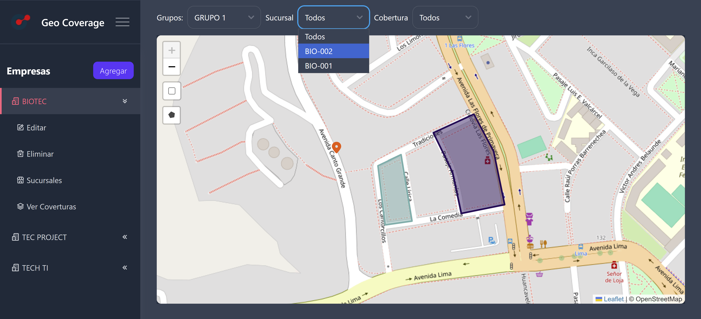
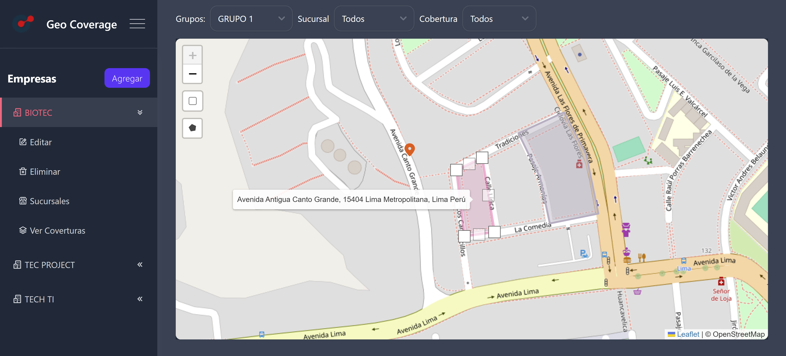

# Geo Coverage Management

**Interactive Geographic Coverage Management with React, TypeScript and Leaflet**


## Overview

Geo Coverage Management is a web application designed to manage companies, branch locations, and geographic coverage areas through an interactive map interface.

The application enables users to create, visualize, edit, and delete geographic polygons using Leaflet. Polygon geometries are represented in Well-Known Text (WKT) format for persistence through a REST API.

The project demonstrates frontend development with React and TypeScript, centralized state management with Redux Toolkit, and integration with geospatial data services.

## Problem Statement

Managing geographic service coverage requires an efficient way to organize companies, register branch locations, and maintain geographic boundaries.

Traditional coordinate-based administration can make geographic information difficult to visualize and update.

Geo Coverage Management addresses this challenge by providing an interactive interface where users can manage company information and directly manipulate geographic coverage polygons on a map.

## Key Features

### Company Management

- Register companies and associate them with groups.
- Select existing companies.
- Edit company information.
- Delete company records.
- Access branch and coverage management options.

### Branch Management

- Register branches associated with companies.
- Manage geographic locations using latitude and longitude coordinates.

### Geographic Coverage Management

- Display existing coverage polygons on an interactive Leaflet map.
- Draw new geographic coverage areas.
- Select existing polygons.
- Edit polygon boundaries.
- Delete geographic coverage areas.
- Represent geographic geometries using WKT for database persistence.

### REST API Integration

- Communicate with the backend using the native Fetch API.
- Centralize HTTP requests through a reusable TypeScript service.
- Configure the backend URL using environment variables.
- Support GET, POST, PUT, and DELETE requests.

## Technology Stack

| Technology | Purpose |
|---|---|
| React | Component-based user interface |
| TypeScript | Static typing |
| Redux Toolkit | State management |
| Leaflet | Interactive maps and geographic visualization |
| Vite | Development server and build tooling |
| Fetch API | HTTP communication |
| WKT | Geographic geometry representation |

## Architecture

The application follows a frontend–backend architecture.

```text
User Interface
      |
React + TypeScript
      |
Components / Pages / Hooks
      |
Redux Toolkit / Services
      |
Native Fetch API
      |
geo-coverage-api
      |
SQL Server
```

The frontend handles user interaction and map visualization, while the backend provides the data operations required for geographic coverage management.

### Project Structure

```text
geo-coverage-management/
├── public/
├── src/
│   ├── assets/
│   ├── components/
│   ├── hooks/
│   ├── layouts/
│   │   ├── Sidebar.tsx
│   │   ├── MainContent.tsx
│   │   └── TopNavbar.tsx
│   ├── pages/
│   │   └── Index.tsx
│   ├── services/
│   │   └── fetchService.ts
│   ├── store/
│   │   └── redux/
│   │       ├── hooks.ts
│   │       └── store.ts
│   ├── styles/
│   ├── types/
│   ├── utils/
│   ├── App.css
│   ├── App.tsx
│   ├── index.css
│   └── main.tsx
├── .env.example
├── .gitignore
├── index.html
├── package.json
├── package-lock.json
├── vite.config.ts
└── README.md
```

### Directory Responsibilities

- `components/`: Reusable UI components.
- `hooks/`: Custom React hooks.
- `layouts/`: Application layout and navigation.
- `pages/`: Application views.
- `services/`: Backend communication services.
- `store/redux/`: Redux store configuration and typed hooks.
- `styles/`: Application styling.
- `types/`: TypeScript interfaces and types.
- `utils/`: Shared utility functions.

## Getting Started

### Prerequisites

- Node.js and npm compatible with the project's Vite version.
- Git.
- A running instance of the related backend service, `geo-coverage-api`.

### 1. Clone the Repository

```bash
git clone https://github.com/pablotorressanchez/geo-coverage-management.git
cd geo-coverage-management
```

### 2. Install Dependencies

```bash
npm ci
```

### 3. Configure Environment Variables

Create a local environment file from the example:

```bash
cp .env.example .env
```

Configure the backend URL:

```dotenv
VITE_API_URL=http://localhost:<API_PORT>
```

Replace `<API_PORT>` with the actual backend port.

The backend URL must match the API's configured address and any applicable route prefix.

**Security:** Vite exposes variables prefixed with `VITE_` to client-side code. Never store private API keys, passwords, or database credentials in these variables.

### 4. Start the Development Server

```bash
npm run dev
```

Open the local URL displayed in the terminal.

### 5. Create a Production Build

```bash
npm run build
```

The generated production files are placed in the build output directory configured by Vite.

## Geographic Data Representation

Geographic coverage boundaries are represented as polygons.

Users can draw and modify polygon geometries through the Leaflet interface. The geometries are represented using Well-Known Text (WKT) for database persistence.

### Example WKT Polygon

```text
POLYGON((
  -77.0500 -12.0500,
  -77.0400 -12.0500,
  -77.0400 -12.0400,
  -77.0500 -12.0400,
  -77.0500 -12.0500
))
```

The example uses synthetic coordinates.

WKT polygon coordinates follow the X Y convention, corresponding to longitude and latitude for geographic coordinates in this example.

## HTTP Communication

The frontend uses a centralized HTTP service implemented with the native Fetch API.

The service:

- Reads the API base URL from `VITE_API_URL`.
- Supports typed responses using TypeScript generics.
- Sends JSON content-type headers.
- Processes JSON responses.
- Returns a standardized error status for unsuccessful HTTP responses.

The service is located at:

```text
src/services/fetchService.ts
```

This abstraction helps maintain a consistent approach to backend communication across the application.

## Screenshots

The following screenshots will be added using demonstration data.

### Company Management


### Branch Management


### Geographic Coverage Visualization



### Polygon Editing



Screenshots will be stored under:

```text
docs/screenshots/
```

## Related Repository

### Geo Coverage API

REST API responsible for supporting the application's backend data operations.

[View Geo Coverage API](https://github.com/pablotorressanchez/geo-coverage-api)

The frontend requires a properly configured backend and its associated database to perform persistent operations.

## Project Status

Portfolio project demonstrating:

- React and TypeScript application development.
- Component-based frontend architecture.
- State management with Redux Toolkit.
- Interactive geospatial visualization.
- Geographic polygon manipulation.
- WKT geometry representation.
- REST API integration.

## Author

GitHub: [pablotorressanchez](https://github.com/pablotorressanchez)
